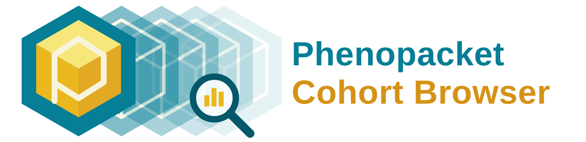

<p align="center">
  
</p>

<p align="center">
  <a href="https://p2gx.github.io/phenopacket-cohort-browser/">
    </a>
  <a href="https://github.com/P2GX/phenopacket-cohort-browser/actions/workflows/ci.yml">
    </a>
  <a href="https://github.com/P2GX/phenopacket-cohort-browser/actions/workflows/deploy.yml">
  <a href="LICENSE">
    </a>
</p>

<h3 align="center">
  ▶&nbsp;<a href="https://p2gx.github.io/phenopacket-cohort-browser/">Open the Cohort Browser</a>&nbsp;—
  
  no install, no upload: drop your phenopacket JSON files and explore.
</h3>

A **privacy-preserving** cohort browser for [GA4GH phenopackets](https://phenopacket-schema.readthedocs.io/).
Drop phenopacket JSON files into the page and browse demographics, diagnoses,
genes, phenotypic features, diseases, measurements and individuals —
**all statistics run inside the browser; no data is ever uploaded.**

The descriptive statistics are plain **Python** (`app/py/cohort_stats/`),
executed in the browser through [Pyodide](https://pyodide.org) (Python
compiled to WebAssembly). Edit a Python function, push, and the
live site updates automatically.

## Quick start (local)

```bash
git clone <this repo>
cd phenopacket-cohort-browser
python3 -m http.server 8000 --directory app
# open http://localhost:8000 and click "Load example cohort"
```

Run the tests:

```bash
pip install pytest ruff
pytest            # unit tests for every statistics function
ruff check .      # lint
```

## Repository layout

```
app/                     ← everything that gets deployed (the website)
  index.html             app shell (dropzone, header, nav)
  css/app.css            all styling (identical to the original viewer)
  js/
    app.js               bootstrap: file loading, Python startup
    config.js            ⚠️ set REPO_URL + site name here
    core/
      pybridge.js        JS ↔ Python (Pyodide) bridge
      registry.js        tab registry — add tabs here-ish (see below)
      tables.js          generic sortable/searchable/paginated table
      charts.js          Chart.js helpers (donut, hbar, histogram, palette)
      format.js          age/number formatting
    tabs/                one file per tab (rendering only, no statistics)
  py/cohort_stats/       ★ THE STATISTICS — plain Python, edit freely
    demographics.py … measurements.py
    __init__.py          compute registry + interactive API
  py/manifest.json       list of Python files the browser loads
  examples/              40 synthetic phenopackets (no real data)
  vendor/chart.umd.min.js
  version.json           version shown in the app (stamped from the git tag by CI)
  sw.js                  offline support (caches app + Python runtime)
tests/                   pytest suite for cohort_stats
tools/
  make_example_cohort.py regenerate the synthetic example data
  build_offline.py       build the fully-offline zip bundle
.github/workflows/
  ci.yml                 lint + tests on every push / PR
  deploy.yml             tests → deploy app/ to GitHub Pages on push to master
  offline-bundle.yml     attach offline zip to GitHub releases
CHANGELOG.md             version history — shown to users on the About tab
```

## How to change a statistic

Everything numerical lives in `app/py/cohort_stats/`. For example, the
median is currently the *upper* median (`sorted[n // 2]`, matching the
original viewer). To switch to an interpolated median, edit `median_of()`
in `utils.py` — every tab picks it up. Add a test in `tests/`, push, done.

## How to add a new tab

1. **Python** — create `app/py/cohort_stats/mytab.py`:

   ```python
   def compute(packets: list) -> dict:
       return {"n": len(packets)}
   ```

   Register it in `TAB_COMPUTES` in `app/py/cohort_stats/__init__.py`
   and add `"cohort_stats/mytab.py"` to `app/py/manifest.json`.

2. **JS** — create `app/js/tabs/mytab.js` (copy `diseases.js`, the smallest
   example) and register it in `app/js/tabs/index.js`.

3. Add a line to `CHANGELOG.md` and push — the deployed site updates
   automatically (the shown version is stamped from the latest git tag).

Interactive controls (dropdowns that recompute) call Python through
`callApi('my_function', {...})` — register the function in `API` in
`__init__.py` (see the Gene × Diagnosis browser for a worked example).

## Releases & version history

- Update `CHANGELOG.md` with every meaningful change — users see it on the
  **About** tab. The version number itself is stamped automatically from the
  latest git tag at build time.
- For a tagged release: `git tag v0.1.2 && git push origin v0.1.2`, then
  publish a GitHub release for that tag — CI attaches the offline bundle
  automatically.

## Run it locally / offline

Three ways, from easiest to most isolated:

1. **Install the web app (recommended for clinicians).** Open the
   [live site](https://p2gx.github.io/phenopacket-cohort-browser/) once, then
   click **Install** (Chrome/Edge — icon at the right end of the address bar)
   or **File → Add to Dock** (Safari, macOS). The Cohort Browser becomes a
   normal app icon and keeps working **fully offline** — the Python runtime
   and the example cohort are cached on the first visit. No security
   warnings, and updates arrive automatically on the next online launch.

2. **Offline bundle (for air-gapped machines).** Download
   `cohort-explorer-offline.zip` from the latest
   [Release](../../releases/latest) (or build it yourself with
   `python tools/build_offline.py`), unzip it, then:

   - **macOS:** double-click `START_MAC.command`.
     *First time only:* macOS warns that Apple "could not verify" the script —
     this project is free and open-source and not notarized by Apple, so this
     warning is expected. Click **Done**, open
     **System Settings → Privacy & Security**, scroll down to
     *"START_MAC.command was blocked"*, click **Open Anyway** and confirm
     once. Every later start is a normal double-click.
     (On macOS 14 or older, right-click → **Open** also works.)
   - **Windows:** double-click `START_WINDOWS.bat`. If a blue SmartScreen
     dialog appears: **More info → Run anyway**.
   - **Any OS:** run `python3 serve.py` inside the unzipped folder
     (never shows a warning).

   The app opens at `http://localhost:8321/` and needs **no internet at
   all**. Note: double-clicking `index.html` directly will *not* work —
   browsers refuse to start the WebAssembly Python engine from a `file://`
   page. That is exactly what the start scripts are for.

3. **From a checkout (developers).** See *Quick start* above.

## Data privacy & responsibility

- **No data is ever uploaded.** Phenopacket files are read locally by your
  browser and analysed by Python-in-WebAssembly on your machine. A
  Content-Security-Policy enforced by the browser blocks the page from
  transmitting anything to any other server. The GitHub Pages server only
  delivers the application code — it never sees your files.
- **The live site is nevertheless a public website.** Using it means your
  browser connects to GitHub's servers to download the application (GitHub
  sees your IP address, as with any website). If you work with **sensitive
  or unpublished patient data**, your institution's policies may restrict
  the use of externally hosted web tools regardless of where the data is
  processed — in that case use the offline bundle or the installed app in
  offline mode, and consult your data-protection officer when in doubt.
- **No warranty, no liability.** This software is provided *“as is”*,
  without warranty of any kind (see [LICENSE](LICENSE)). The authors and
  contributors cannot take responsibility for how the tool is used or for
  any consequences of using it with sensitive data. **You remain responsible
  for compliance with your local data-protection regulations (e.g. GDPR) and
  your institution's policies.**

## License

MIT — see `LICENSE`.
